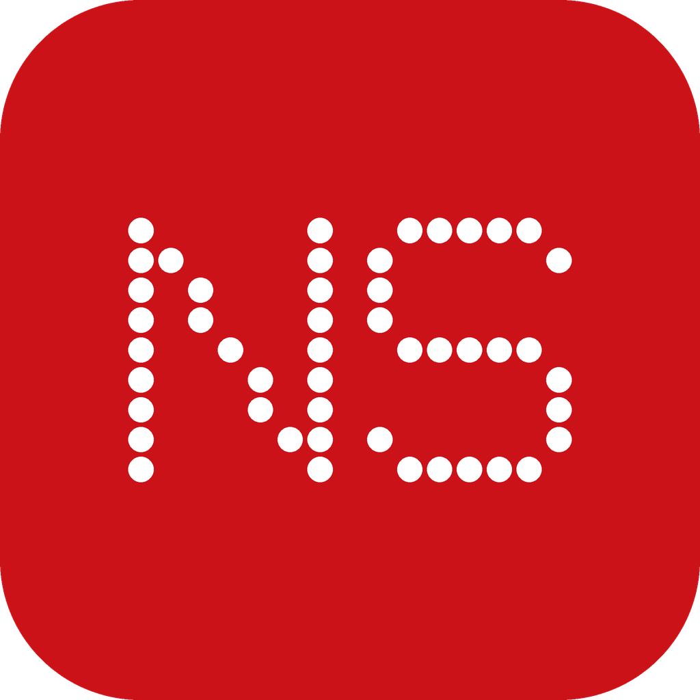
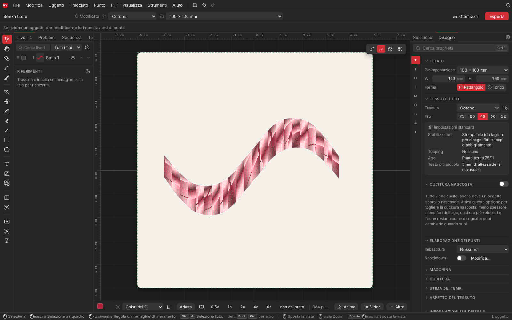
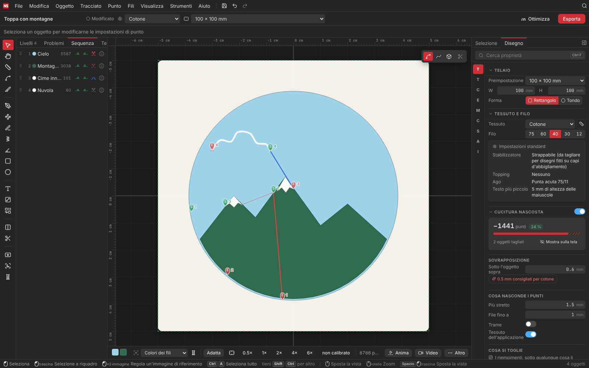
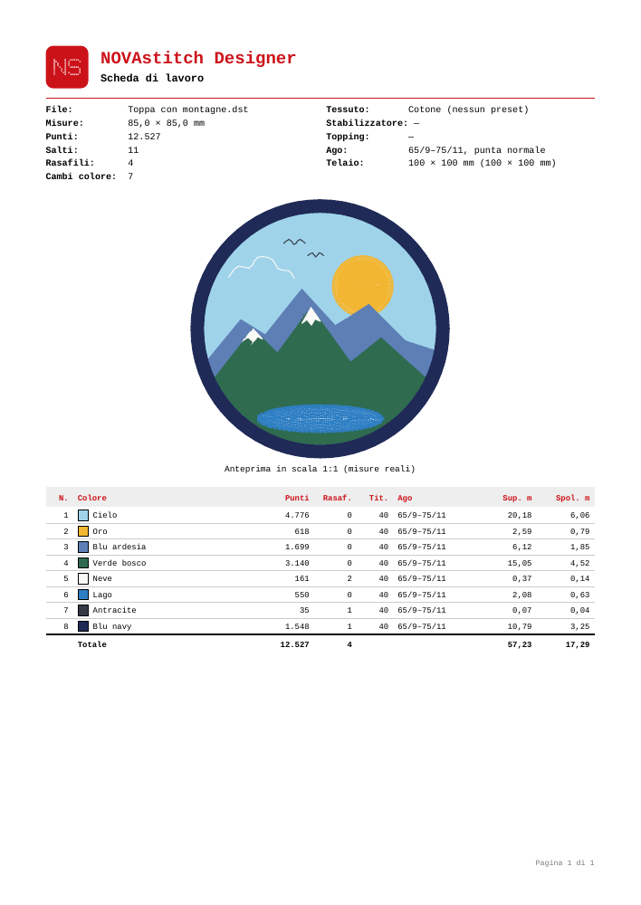

# NOVAstitch Designer

  

  <b>Digitalizzazione del ricamo, con le regole del mestiere.</b> 
  <b>Embroidery digitizing, with the rules of the trade built in.</b> 
  Open source (GPL-3.0) · italiano e inglese · Windows e Linux

**Stato / Status.** Versione 0.1 (pre-release), quasi pronta. / Version 0.1 (pre-release), nearly ready. Scarica / Download: [Releases](../../releases).

   
  
  

---

## Italiano

NOVAstitch Designer è un programma per **digitalizzare ricami a partire da disegni vettoriali**: si disegnano forme e linee, si sceglie come cucirle, il programma calcola i punti ed esporta per la macchina. È fatto da chi ricama per lavoro, per avvicinare gli strumenti professionali a chiunque, senza nascondere i parametri a chi li sa usare.

### Strumenti da professionista
- **Satin a due binari a click alternati**: binario sinistro, destro, sinistro… con nodi dritti o curvi; i binari non devono essere paralleli.
- **Dividi e dirigi**: su una forma importata (per esempio una lettera) si tracciano i tagli e le direzioni dei punti, e si ottengono le colonne di satin, ciascuna con il suo angolo.
- **Sequenza di cucitura sotto controllo**: ordine degli oggetti trascinabile, fermature, rasafili, stop; partenze e arrivi visibili su tutto il disegno; i **collegamenti** tra un oggetto e l'altro colorati (rosso rasafilo, blu salto, verde cucitura) e modificabili con un clic.
- **Croce del cursore al decimo di millimetro**, griglia e griglia bersaglio, **zoom 1:1 reale** dopo una calibrazione con il righello.
- **Percorso ago** e **simulatore della cucitura** per controllare ogni penetrazione.
- **Effetti speciali**: satin su **schiuma 3D** con cappucci automatici, **3D a strati**, **appliqué** con posizionamento, tack-down e copertura, e appliqué a bordo libero.
- **Patch e libreria**: griglie di copie indipendenti con ordine per colore o per copia.

### Preset professionali per tessuto
Tredici preset (cotone, maglia, piqué, pile, spugna, denim, pelle, cappellino…) con valori presi dalla letteratura tecnica del ricamo: compensazione della trazione, **sovrapposizione tra oggetti** contro le fessure, sottopunti di contorno, a zigzag e incrociati, doppio contorno sulla maglia. Ogni preset ha una **scheda per chi ricama** (stabilizzatore, topping, ago) e gli **avvisi** segnalano ciò che cucirebbe male: punti troppo fitti, satin troppo larghi, ordine sbagliato sui tessuti elastici. Ogni valore si può ritoccare a mano: il preset non lo sovrascrive più.

### Facile da usare
- Interfaccia **in italiano e in inglese**.
- I valori giusti arrivano dal tessuto scelto: si comincia a ricamare senza conoscere ogni parametro.
- In arrivo: modalità **Assistito**, in cui il programma applica le regole del mestiere e chi disegna sceglie solo tessuto, telaio, colori e tipo di riempimento; e le **lezioni guidate** (Apprentice Mode).

### Per la produzione
- **Scheda di lavoro PDF** per l'operatore: anteprima in scala, tabella colori, **metri di filo** superiore e spolina, ago, stabilizzatore, avvisi per cappellino, appliqué, schiuma e filo metallico.
- Esportazione nei formati macchina più diffusi (DST, PES, JEF, EXP, VP3 e altri); telai delle macchine e telai personali, compresi quelli da cappello.

### Formato aperto `.nsd`
I progetti si salvano in `.nsd`: testo JSON leggibile, con schema pubblico, pensato come **standard aperto** per i disegni da ricamo modificabili. I file `.filum` si aprono.

---

## English

NOVAstitch Designer is software for **digitizing embroidery from vector artwork**: draw shapes and lines, choose how to stitch them, and the program computes the stitches and exports them for the machine. It is made by people who embroider for a living, to bring professional tools within everyone's reach without hiding the parameters from those who know how to use them.

### Professional tools
- **Two-rail satin by alternate clicks**: left rail, right rail, left… with corner or curved nodes; rails need not be parallel.
- **Split and direct**: on an imported shape (a letter, for example) draw the cuts and the stitch directions, and get satin columns, each with its own angle.
- **Sewing sequence under control**: drag to reorder, ties, trims, stops; start and end points shown for the whole design; **connections** between objects colour-coded (red trim, blue jump, green sewn) and changed with one click.
- **Cross-hair cursor to a tenth of a millimetre**, grid and target grid, **true 1:1 zoom** after a ruler calibration.
- **Needle path** and **stitch-out simulator** to check every penetration.
- **Special effects**: satin over **3D foam** with automatic caps, **layered 3D**, **appliqué** with placement, tack-down and cover, and frayed-edge appliqué.
- **Patches and library**: grids of independent copies, sewn by colour or by copy.

### Professional fabric presets
Thirteen presets (cotton, knit, piqué, fleece, towel, denim, leather, cap…) with values from the technical literature of embroidery: pull compensation, **overlap between objects** against gaps, contour, zig-zag and cross-hatched underlays, double contour on knits. Every preset has a **sheet for the embroiderer** (stabilizer, topping, needle), and **warnings** flag what would sew badly: stitches too dense, satins too wide, wrong order on stretch fabrics. Every value can be changed by hand, and the preset then leaves it alone.

### Easy to use
- Interface **in Italian and English**.
- The right values come from the fabric you choose: start embroidering without knowing every parameter.
- Coming next: **Assisted** mode, where the program applies the rules of the trade and you only choose fabric, hoop, colours and fill type; and **guided lessons** (Apprentice Mode).

### For production
- **PDF worksheet** for the operator: preview to scale, colour table, top and bobbin **thread length**, needle, stabilizer, notes for caps, appliqué, foam and metallic thread.
- Export to the common machine formats (DST, PES, JEF, EXP, VP3 and more); machine hoops and your own hoops, cap frames included.

### Open `.nsd` format
Projects are saved as `.nsd`: readable JSON text with a public schema, meant as an **open standard** for editable embroidery designs. `.filum` files open too.

---

## Crediti / Credits

NOVAstitch Designer è una versione modificata di [Filum](https://github.com/benkl/filum) di Benjamin Kleinert e degli algoritmi di [Ink/Stitch](https://inkstitch.org), l'estensione per il ricamo di [Inkscape](https://inkscape.org). Grazie a tutti i loro autori. / NOVAstitch Designer is a modified version of benkl's Filum and of the algorithms of Ink/Stitch, the embroidery extension for Inkscape. Thanks to all their authors.

## Licenza / License

GPL-3.0. Vedi `LICENSE`. Basato su Filum: vedi `NOTICE`. / Based on Filum: see `NOTICE`.

Copyright (c) 2026 Poletti Centro Cucito.
